# Bancada

**Do LED ao computador, montando cada peça.**

A Bancada é um jogo educativo sobre como um computador funciona por dentro. Você começa acendendo um LED com uma bateria e um resistor, passa pelos transistores, pelas portas lógicas, pela soma em binário e pela memória, e termina programando dois computadores feitos só de peças que você mesmo poderia montar: um de 16 bits, criado para o curso, e um MIPS de 32 bits.

Tudo o que aparece na tela é simulado de verdade. Os fios mostram os bits que levam, o LED acende pela corrente que passa nele, e qualquer peça pode ser aberta para ver do que ela é feita, até chegar aos transistores.

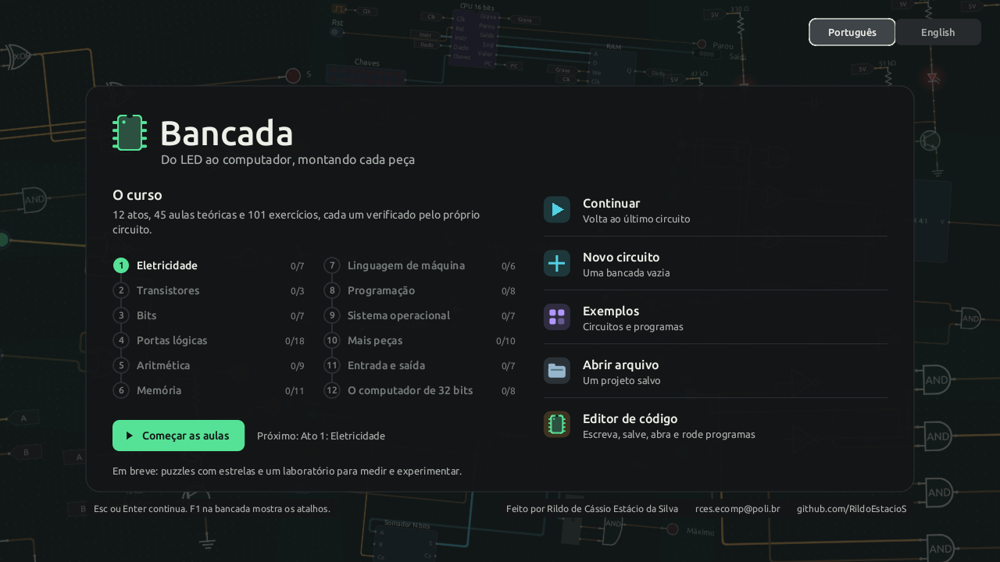

## Como jogar

Não precisa instalar nem compilar nada. Os executáveis prontos ficam na pasta [`jogar`](jogar).

**Windows 10 ou 11 (64 bits):** baixe [`jogar/windows/bancada.exe`](jogar/windows/bancada.exe) e dê dois cliques.
O programa ainda não tem assinatura digital, então o Windows pode avisar "O Windows protegeu o computador". Nesse caso, clique em **Mais informações** e depois em **Executar assim mesmo**. Em PCs com o Controle Inteligente de Aplicativos ligado, o Windows bloqueia o programa até ele ser assinado.

**Linux (64 bits, Ubuntu 22.04 ou mais novo, Debian 12, Fedora 36, Mint 21 ou equivalente):** baixe [`jogar/linux/bancada`](jogar/linux/bancada) e, na pasta onde ele estiver, rode:

```bash
chmod +x bancada
./bancada
```

O `chmod` só é preciso na primeira vez, porque o GitHub não guarda a permissão de execução.

**Android 7.0 ou mais novo:** baixe [`jogar/android/bancada.apk`](jogar/android/bancada.apk) no celular e abra o arquivo. O Android pede para permitir a instalação de apps de fora da loja. Se ele disser que o app não foi instalado, desinstale a versão anterior da Bancada e tente de novo.

Para levar o jogo num pendrive com os seus circuitos, crie uma pasta `dados` ao lado do executável: tudo o que o jogo salvar fica nela.

## O que tem no jogo

### Um curso inteiro, do LED ao sistema operacional

São **12 atos, 45 aulas teóricas e 101 exercícios**: eletricidade, transistores, bits, portas lógicas, aritmética, memória, linguagem de máquina, programação, sistema operacional, mais peças, entrada e saída e o computador de 32 bits. Cada ato abre quando os exercícios do anterior estão feitos.

| | |
|---|---|
| 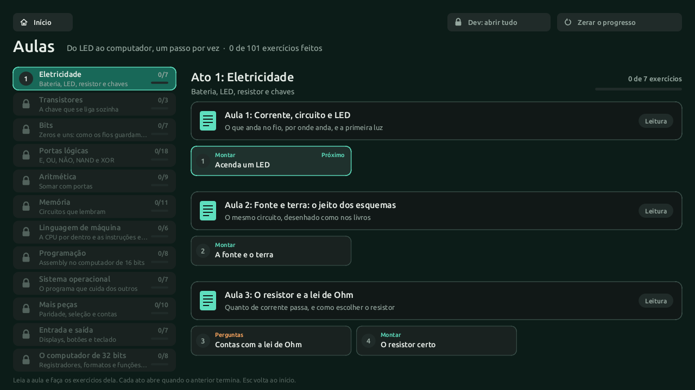 | 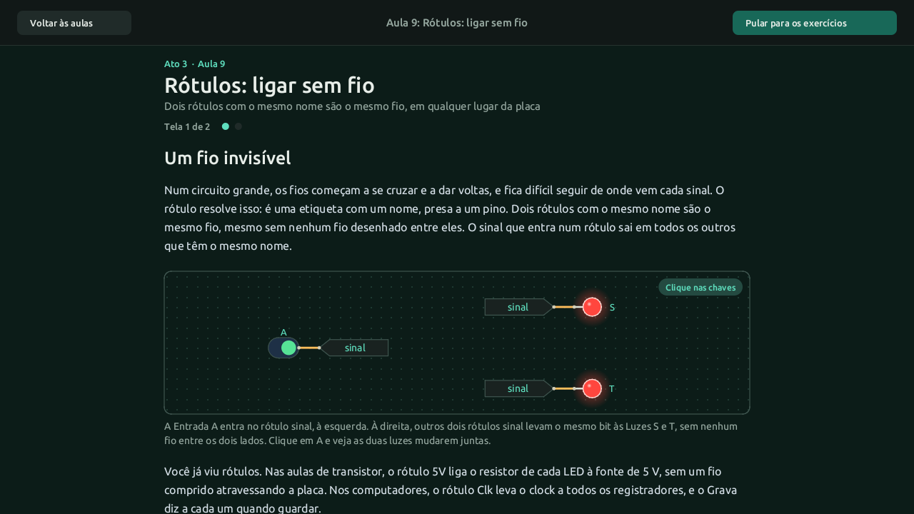 |

- **Aulas em telas**, uma ideia por tela, com perguntas no meio (a tela seguinte só abre com a resposta certa, e a errada mostra uma dica), circuitos de verdade em que se clica nas chaves, tabelas, exemplos resolvidos passo a passo, erros comuns e um resumo no fim.
- **Exercícios que se verificam sozinhos**: o jogo testa o circuito em todas as combinações de entrada, roda o programa no próprio computador ou confere a resposta digitada (em decimal, binário ou hexadecimal). Verificar diz o que falta e Dica ajuda sem entregar a resposta.
- **Em degraus**: primeiro perguntas, depois usar a peça pronta, depois montá-la por dentro. As saídas são LEDs de verdade, com resistor e terra.
- **Em breve**, apagados no fim de cada ato: ponto flutuante, mapas de Karnaugh, máquinas de estados, pipeline, desempenho, cache, compilador, memória virtual, interrupções e DMA.

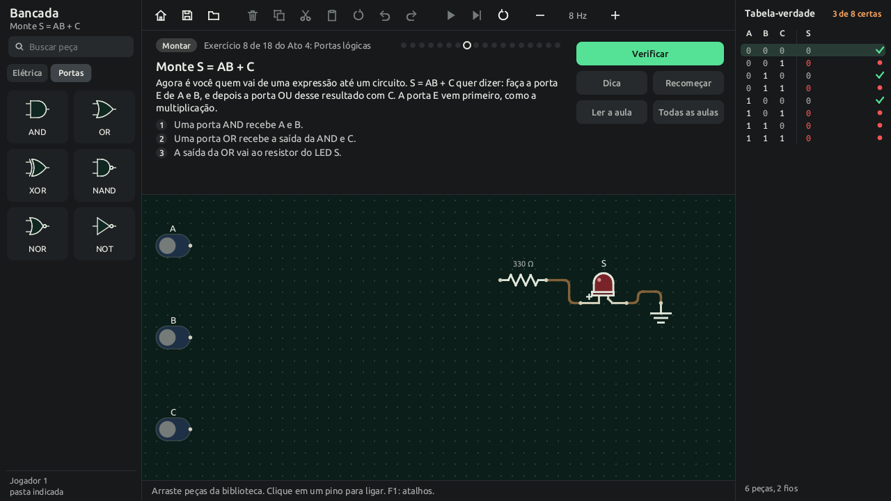

### Um editor de circuitos

- **Lógica**: portas E, OU, NÃO, NAND, NOR, XOR e XNOR, com quantas entradas quiser.
- **Biblioteca de peças prontas** de 1 a 64 bits: somador, subtrator, comparador, ULA, multiplexador, decodificador, codificador de prioridade, deslocador, extensor, multiplicador, divisor, latch, flip-flop, registrador, contador, banco de registradores, RAM e ROM.
- **Entrada e saída**: chave, botão, display de 7 segmentos, teclado, matriz de LEDs 8×8 e terminal de texto.
- **Barramentos** de 1 a 64 bits, com separador, juntador e constante.
- **Rótulos**: dois rótulos com o mesmo nome são o mesmo fio, sem fio desenhado entre eles.
- **Chips**: qualquer circuito do projeto vira uma caixa, inclusive dentro de outros chips.
- **Tabela-verdade** ao lado, recalculada a cada mudança.
- **Clock** com Rodar, Pausar, passo a passo e velocidade ajustável.
- Desfazer, copiar e colar, salvar e abrir projetos, salvamento automático e perfis de jogador.

### Eletrônica de verdade

Bateria, fonte, terra, resistor, diodo, LED, chave, capacitor e transistores NPN, PNP, NMOS e PMOS, resolvidos como no SPICE. Corrente e tensão aparecem nos fios e ao passar o mouse, e o LED acende pela corrente que passa nele. O simulador elétrico é conferido contra o ngspice.

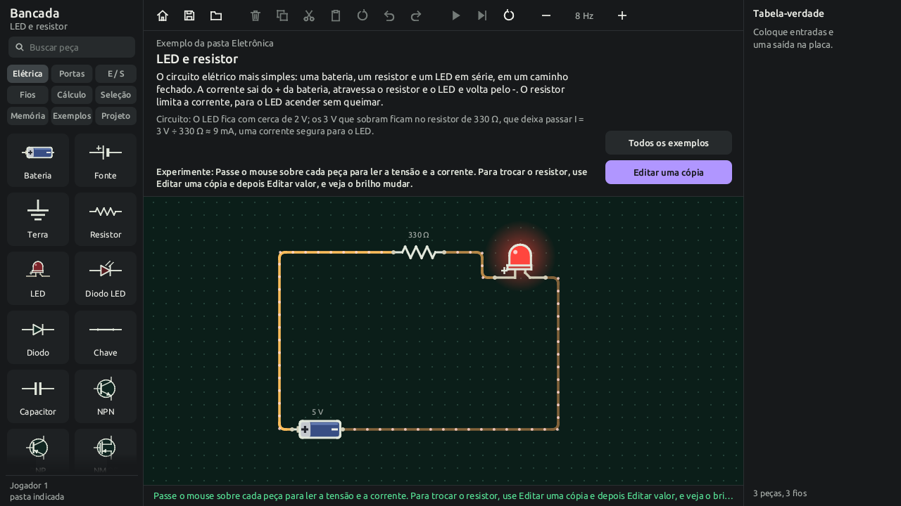

### Ver por dentro

Clique duplo em qualquer peça (ou Ver por dentro no painel) abre a peça por dentro, só para ver: uma porta vira transistores ou só NANDs, um multiplexador vira portas lógicas, e as peças maiores viram blocos menores. Clique duplo de novo desce mais um nível. Separador e Juntador, que não têm porta nenhuma, mostram os seus fios bit a bit.

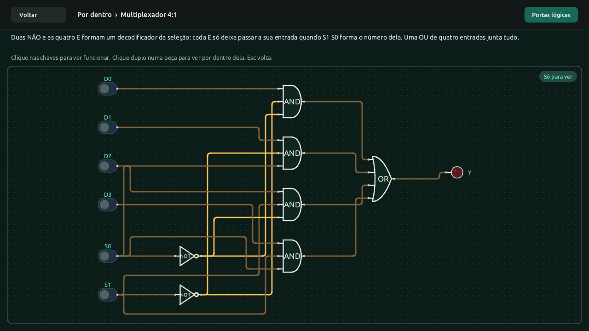

### 70 exemplos prontos

Eletrônica, portas lógicas, contas de 1 e de N bits, memória, programas para o computador e um sistema operacional pequeno (chamadas de sistema e duas tarefas). Muitos exemplos têm várias versões: a peça pronta, feita de portas lógicas, feita de transistores ou de blocos menores, e um teste confere que todas dão a mesma tabela-verdade.

Os exemplos são só para ver: as chaves e botões funcionam, mas o circuito não muda. **Editar uma cópia** abre o mesmo circuito como um projeto seu, e mudar a cópia não muda o exemplo.

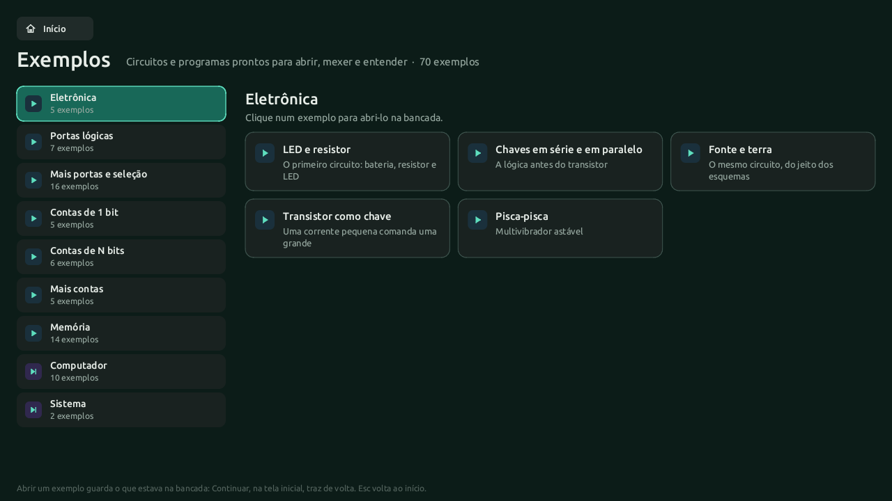

### O computador de 16 bits

Uma CPU feita só de peças do editor: contador de programa, ROM, decodificador, banco de 8 registradores, ULA, RAM e controle. Tem assembler próprio, com 16 instruções de 16 bits cada.

- **Painel**: o caminho de dados desenhado com os valores de cada fio, ao lado de um depurador com o programa, pontos de parada, registradores e memória. Embaixo, o **passo a passo** do que cada instrução fez e a **memória** que o programa usa, com o que mudou.
- **Raio-X**: a instrução atual passando pelas seis etapas (busca, decodifica, executa, memória, escreve e próximo PC), cada campo dos 16 bits na sua cor, com o texto do que acontece em cada etapa.

| | |
|---|---|
| 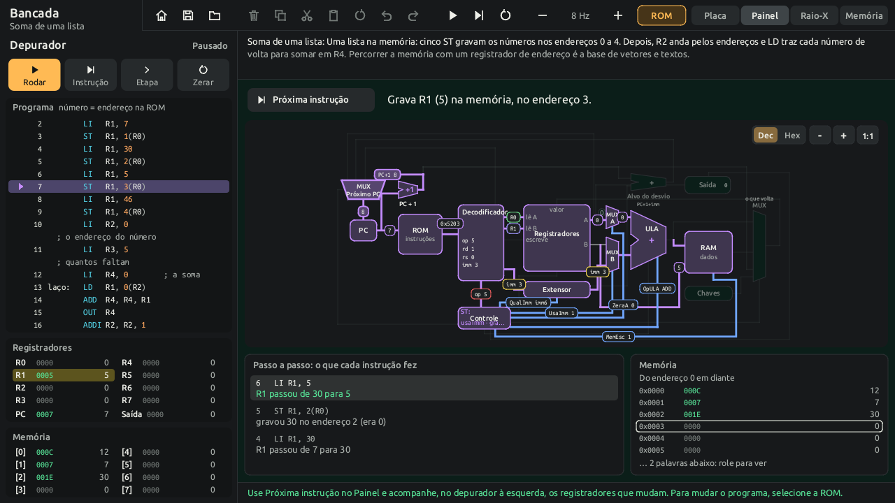 | 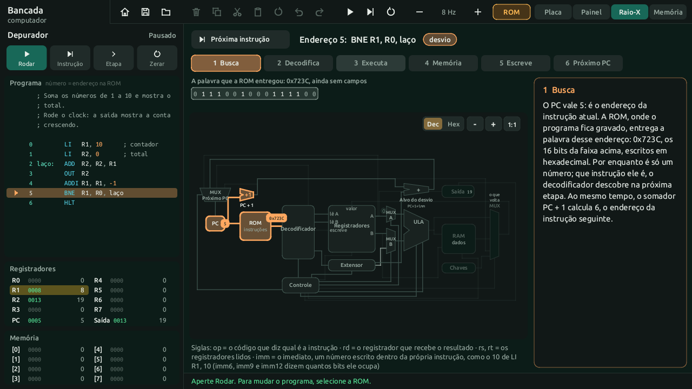 |

### O computador de 32 bits (MIPS)

Um MIPS de 32 bits com os formatos R, I e J, 32 registradores (`$t0`, `$s0`, `$sp`...), `.data` e `.word`, pseudoinstruções como `li` e `la`, `jal` e `jr`, e `syscall` para mostrar números e letras.

- **Painel**: como no computador de 16 bits, a arquitetura inteira com o valor de cada fio. Embaixo, uma **Memória** que rola e cresce conforme o programa usa, mostrando onde apontam `$gp` e `$sp` e o que mudou.
- **Passo a passo**: o que cada instrução fez, em português ("`$t1` passou de 0 para 5", "gravou 1 em contador (era 0)").
- **Aba Memória**: uma palavra por linha, com o endereço, o valor em hexadecimal e em decimal, quem aponta para ela e a última mudança; ao lado, os 32 registradores e o PC, com o que a última instrução mudou em destaque. O computador de 16 bits tem a mesma aba, com R0 a R7, o PC e a saída.

| | |
|---|---|
| 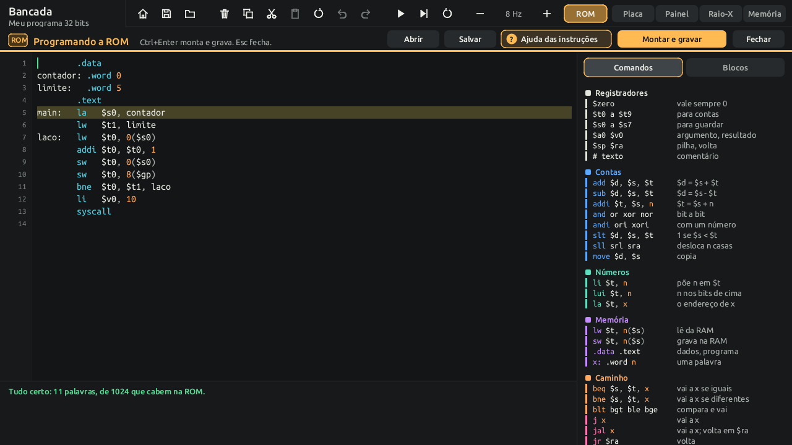 | 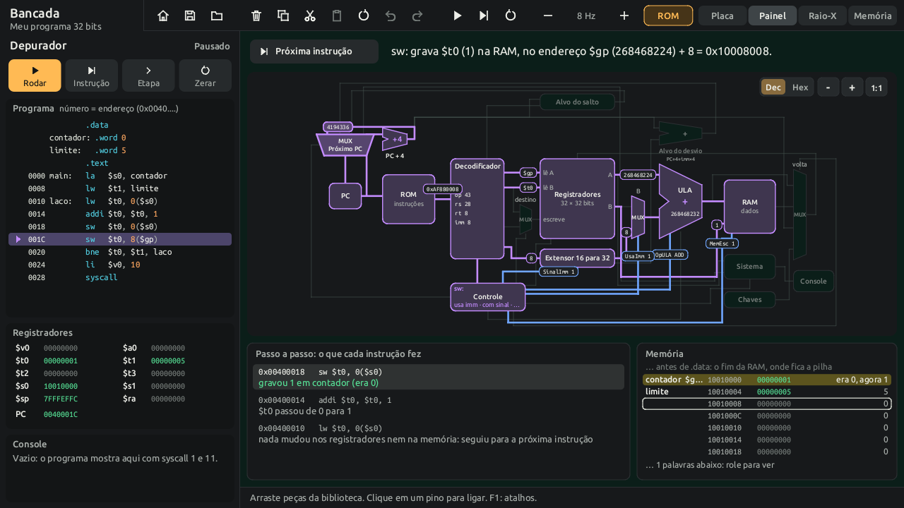 |

### Editor de código

Um editor para os dois computadores, com cores, ajuda de todas as instruções e mensagens de erro na linha certa. **Salvar** e **Abrir** guardam o programa num arquivo de texto (`.asm` para o de 16 bits, `.s` para o MIPS), e `Ctrl+Enter` monta e grava na ROM.

### Os computadores inteiros, ao vivo

Na tela Editor de código, **Por dentro** mostra cada computador inteiro, peça por peça, de três jeitos: portas lógicas, as NANDs de cada porta e os transistores de cada NAND. A CPU de 16 bits tem 2.632 portas lógicas, 3.149 NANDs e mais de 7 milhões de transistores contando a memória. Os fios acendem com o circuito rodando.

| | |
|---|---|
| 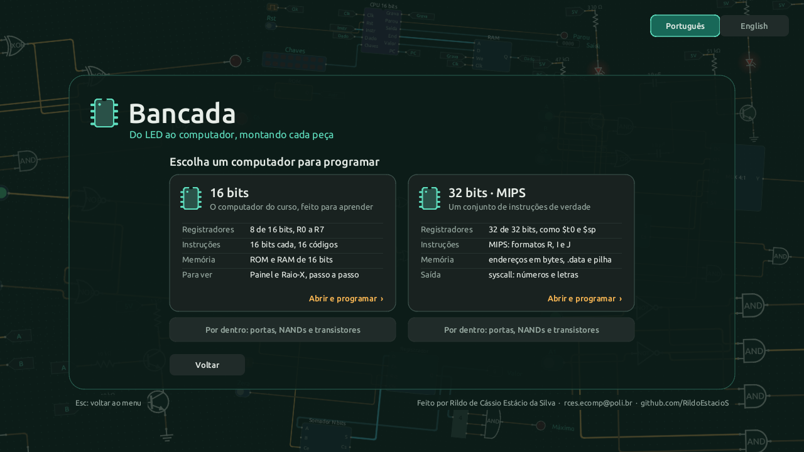 | 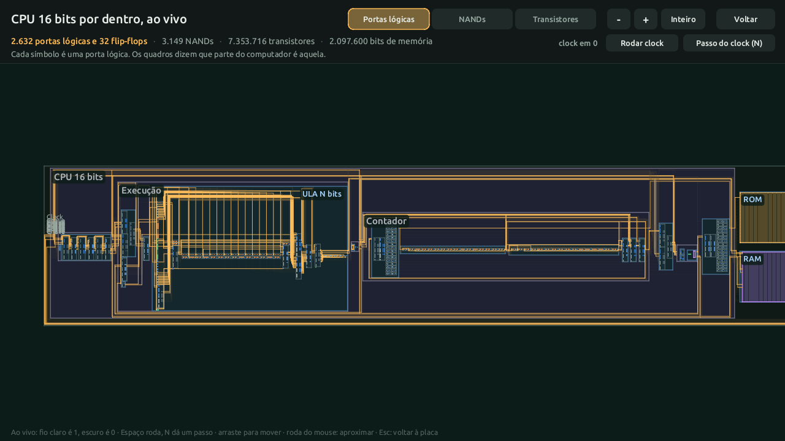 |

### Português e inglês

O jogo inteiro existe nos dois idiomas, escolhidos no canto da tela inicial. Os testes conferem que todas as aulas, exemplos e peças estão traduzidos.

## Referências

Os textos, circuitos e exercícios da Bancada são próprios. Para escrevê-los e conferir se estão corretos, foram usados estes livros e materiais.

### Livros

- **William Stallings, *Arquitetura e Organização de Computadores*** (Pearson). A referência principal: os conceitos das aulas foram conferidos contra o livro e adaptados a partir dele, da representação dos dados e da aritmética do computador até a memória, o conjunto de instruções e a estrutura da CPU.
- **David A. Patterson e John L. Hennessy, *Organização e Projeto de Computadores: a interface hardware/software*** (Elsevier). Base do computador de 32 bits: a arquitetura MIPS, os formatos R, I e J, o cartão de referência das instruções (o "green sheet") e o caminho de dados.
- **James R. Larus, *Assemblers, Linkers, and the SPIM Simulator*** (apêndice do livro de Patterson e Hennessy) e a documentação do simulador SPIM. Base das chamadas de sistema (`syscall`), das diretivas `.data`, `.text` e `.word` e do mapa de memória do MIPS (`$gp` em `0x10008000`, `.data` em `0x10010000`, `$sp` em `0x7FFFEFFC`).
- **Noam Nisan e Shimon Schocken, *The Elements of Computing Systems*** (MIT Press, o curso Nand2Tetris). A ideia de construir o computador inteiro a partir da porta NAND, que é a única porta primitiva do simulador.
- **Charles Petzold, *Code: The Hidden Language of Computer Hardware and Software*** (Microsoft Press). A sequência que vai do circuito elétrico com chaves até o computador.
- **David Money Harris e Sarah L. Harris, *Digital Design and Computer Architecture*** (Morgan Kaufmann). Consultado para a ordem dos assuntos de lógica digital e arquitetura.

### Materiais de curso e referência do MIPS

- Tutorial do MARS (Missouri State University), o ambiente de MIPS usado em muitos cursos, consultado para o editor de código.
- *MIPS Reference Data*, a tabela de codificação das instruções, e *MIPS Reference Guide* (University of Cambridge).
- Materiais de aula sobre MIPS da Cornell University (CS 3410), da University of California, Berkeley (CS 61C), da University of Washington (CSE 378) e da King Fahd University of Petroleum and Minerals (COE 301).

### Currículo

- ACM/IEEE-CS/AAAI, *Computer Science Curricula 2023* (CS2023): os conhecimentos de arquitetura e organização esperados num curso de computação.
- Planos de ensino e apostilas de arquitetura e organização de computadores de instituições brasileiras (IFPB, IFCE, IFF, USP, UFU e o repositório eduCAPES), para alinhar o curso ao que se ensina no Brasil.

### Ferramentas, bibliotecas e fonte

- [ngspice](https://ngspice.sourceforge.io/): o simulador elétrico da Bancada é conferido contra ele (`tools/compare_spice.py`).
- [SDL3](https://www.libsdl.org/): janela, desenho e entrada, no Windows, no Linux e no Android.
- [zstd](https://github.com/facebook/zstd) e [xxHash](https://github.com/Cyan4973/xxHash): compressão e verificação dos arquivos de projeto.
- [nlohmann/json](https://github.com/nlohmann/json): leitura e escrita do conteúdo dos projetos.
- Família de fontes **Ubuntu** (Ubuntu, Ubuntu Medium e Ubuntu Mono), embutida no jogo sob a Ubuntu Font Licence 1.0; o aviso está em [`assets/fonts/LICENCA-fonte-ubuntu.txt`](assets/fonts/LICENCA-fonte-ubuntu.txt).

## Usar o editor

| Ação | Como |
|---|---|
| Colocar peça | Arraste da biblioteca para a placa, ou clique nela e depois na placa; `R` gira; `Esc` termina |
| Ajustar peça | Selecione e use o painel da direita, ou `+` e `-` para entradas e `[` e `]` para tamanho |
| Ligar fio | Clique em um pino e depois no destino, ou arraste de pino a pino |
| Fixar o caminho | Durante o fio, clique no vazio para fixar um ponto; `Shift` força um trajeto em L |
| Derivar um fio | Arraste a partir do meio de um fio, ou termine um fio em cima de outro |
| Ponta solta | `Enter` encerra o fio no cursor; clique na ponta para continuar depois |
| Selecionar | Clique na peça ou no fio, ou arraste no vazio; `Shift` adiciona; `Ctrl+A` seleciona tudo |
| Mover e girar | Arraste a peça; `R` ou o botão Girar gira a seleção |
| Apagar | Botão Apagar, `Delete` ou `Backspace` |
| Copiar e colar | `Ctrl+C`, `Ctrl+X`, `Ctrl+V` ou os botões; a cópia segue o cursor e um clique a posiciona |
| Desfazer | `Ctrl+Z`, e `Ctrl+Y` ou `Ctrl+Shift+Z` para refazer |
| Navegar | Roda do mouse dá zoom; botão direito ou do meio move a vista; `F` enquadra |
| Simular | Clique em uma entrada para ligar ou desligar; em entradas de vários bits, clique no bit; `T` mostra ou esconde a tabela |
| Bits | Selecione a peça e use Bits no painel, ou `,` e `.`; um fio entre larguras diferentes fica vermelho |
| Clock | Coloque um Clock e use Rodar, Passo e Zerar na barra; `Espaço` roda ou pausa, `N` dá meio ciclo |
| Rótulos | Arraste um Rótulo da pasta Fios e dê um nome no painel; clique num rótulo e todos com o mesmo nome ficam em laranja |
| Por dentro | Clique duplo numa peça, ou Ver por dentro no painel; clique duplo lá dentro desce mais um nível; `Esc` volta |
| Chips | Em Circuitos do projeto, clique em + Novo chip; suas Entradas e saídas viram os pinos; arraste o nome para a placa; clique no nome ou dê duplo clique no chip para abrir |
| ROM e constante | Selecione e use Editar conteúdo ou Editar valor, em hexadecimal |
| Programa | Selecione uma ROM e use Programar a ROM; `Ctrl+Enter` monta e grava |
| Editor de código | Na tela inicial, Editor de código, e escolha 16 bits ou 32 bits · MIPS; Salvar e Abrir guardam o programa em arquivo |
| Exemplos | Na tela inicial, Exemplos; os botões acima da placa trocam a versão; Editar uma cópia abre o circuito para mudar |
| Painel e Raio-X | Com um computador na placa, use Painel ou Raio-X na barra; clique numa linha do programa para parar nela |
| Memória | No computador de 32 bits, a aba Memória lista uma palavra por linha; a roda do mouse rola a memória do painel |
| Aulas | Na tela inicial, Começar as aulas; leia a aula antes dos exercícios; Verificar diz o que falta e Dica ajuda |
| Eletrônica | Arraste bateria, resistores e transistores; clique na chave para fechá-la; passe o mouse para medir; Editar valor aceita `4k7`, `220`, `10u` |
| Tela inicial | O botão da casinha, no começo da barra; o circuito fica salvo e Continuar o traz de volta |
| Idioma | Na tela inicial, Português ou English, no canto de cima |
| Salvar | `Ctrl+S`; `Ctrl+Shift+S` salva com outro nome |
| Abrir | `Ctrl+O`, ou solte um arquivo `.bancada` na janela |
| Novo projeto | `Ctrl+N` |
| Perfis | `P` abre a lista; digite um nome e tecle `Enter` para criar um novo |
| Atalhos | `F1` |

O jogo salva sozinho a cada 30 segundos e ao fechar, em um arquivo separado do projeto, e reabre de onde parou.

## Compilar

### Windows (terminal MSYS2 UCRT64)

```bash
pacman -S --needed mingw-w64-ucrt-x86_64-gcc mingw-w64-ucrt-x86_64-cmake mingw-w64-ucrt-x86_64-ninja mingw-w64-ucrt-x86_64-sdl3 mingw-w64-ucrt-x86_64-zstd mingw-w64-ucrt-x86_64-xxhash mingw-w64-ucrt-x86_64-nlohmann-json
cmake -S . -B build -G Ninja
cmake --build build
ctest --test-dir build --output-on-failure
```

O `.exe` sai com ícone, nome e versão. O nome que aparece como autor nas Propriedades vem de `-DBANCADA_AUTHOR="Seu Nome"` (sem acentos). O ícone é gerado por `python3 tools/make_icon.py`.

#### Assinatura e bloqueio do Windows

O Controle Inteligente de Aplicativos do Windows 11 bloqueia todo programa sem assinatura que a Microsoft ainda não conhece. Ele não acusa vírus: o bloqueio aparece no log `Microsoft-Windows-CodeIntegrity/Operational`, eventos 3033 e 3077. O SmartScreen faz algo parecido com programas baixados da internet.

A solução é assinar o `.exe` com um certificado de assinatura de código de uma autoridade reconhecida pela Microsoft. Certificado autoassinado não serve. Com o certificado em mãos:

```powershell
powershell -ExecutionPolicy Bypass -File tools\assinar_windows.ps1 -Impressao <SHA-1 do certificado>
powershell -ExecutionPolicy Bypass -File tools\assinar_windows.ps1 -Conferir
```

O script também aceita o Artifact Signing da Microsoft (`-Metadados metadata.json -Dlib Azure.CodeSigning.Dlib.dll`) e precisa do `signtool.exe` do Windows SDK. Mesmo assinado, um programa novo pode receber aviso do SmartScreen até ganhar reputação.

### Linux (Ubuntu 22.04)

Sem SDL3 instalado, o CMake baixa e compila a versão fixada em `CMakeLists.txt`, que precisa destes pacotes:

```bash
sudo apt install build-essential cmake ninja-build git pkg-config libzstd-dev libxxhash-dev nlohmann-json3-dev libx11-dev libxext-dev libxrandr-dev libxcursor-dev libxi-dev libxss-dev libxtst-dev libxkbcommon-dev libwayland-dev libdecor-0-dev libegl1-mesa-dev libgl1-mesa-dev libgbm-dev libdrm-dev libasound2-dev libpulse-dev libdbus-1-dev libudev-dev
```

```bash
cmake -S . -B build -G Ninja
cmake --build build
ctest --test-dir build --output-on-failure
```

Para compilar só o núcleo, sem janela, use `-DBANCADA_APP=OFF`.
Para conferir o simulador elétrico contra o ngspice: `python3 tools/compare_spice.py build/bancada_electric_cli`.
Para detectar erros de memória no Linux, use `-DBANCADA_SANITIZE=ON`.

### Android

O projeto do Android fica em [`android`](android). Ele compila o mesmo C++ do computador, com o SDL dentro, usando o Android SDK, o NDK 28.2.13676358 e o CMake 3.31.6. Os caminhos das ferramentas desta máquina vão em `android/local.properties`, que fica fora do git; [`android/app/build.gradle`](android/app/build.gradle) explica cada um. Com eles no lugar:

```powershell
cd android
.\gradlew.bat assembleDebug
```

O APK sai em `android/app/build/outputs/apk/debug/` e é copiado para `jogar/android/bancada.apk`.

## Estrutura do código

| Pasta | O que tem |
|---|---|
| `src/sim` | Núcleo lógico: netlist, compilação com detecção de laços, interpretador de referência e simulador orientado a eventos |
| `src/electric` | Simulador elétrico, resolvido como no SPICE |
| `src/editor` | Placa, fios, roteamento, desfazer, peças prontas, chips, os dois computadores, aulas, exemplos e tabela-verdade, tudo testável sem janela |
| `src/asm` | Montadores do computador de 16 bits e do MIPS |
| `src/io` | Projetos, salvamento automático, migrações e perfis |
| `src/i18n` | Catálogo em inglês |
| `src/app` | A janela SDL3, que desenha tudo e traduz os eventos |
| `tests` | 15 grupos de testes, que resolvem todos os exercícios e conferem os exemplos, os computadores e as traduções |

## Modo portátil

Crie uma pasta `dados` ao lado do executável. Se ela existir, tudo o que o jogo salvar fica nela.
Sem essa pasta, ele usa a pasta do usuário no sistema.

## Formato dos projetos

Um `.bancada` tem um cabeçalho e blocos independentes, cada um comprimido com zstd e verificado com XXH3.
O conteúdo é JSON e guarda só o que o jogador fez. Netlists e código compilado nunca são salvos.

- Todo arquivo é tratado como entrada não confiável e validado por inteiro antes de virar uma placa.
- Blocos desconhecidos são ignorados, então versões antigas do jogo abrem arquivos com blocos novos.
- Mudar o formato exige subir `kFormatVersion` e acrescentar um passo de migração em `src/io/project.cpp`.
- Os arquivos em `tests/fixtures` (da versão 1 à 10 do formato) precisam abrir para sempre. Nunca regenere um deles para um teste passar.
- As hashes detectam danos, não adulteração: isto não é uma medida de segurança.

## Regras do editor

- O desenho de um fio nunca decide o que ele liga: só pinos e juntas ligam.
- Cruzar ou passar por cima de outro fio nunca cria conexão. Um ponto marca toda ligação real.
- O roteador só sugere caminhos. Cliques do jogador têm prioridade e sobrevivem na placa.
- A placa é a fonte da verdade. Netlist e simulador são derivados e descartáveis.
- Ligar uma entrada não é uma edição e não entra no histórico.

## Regras do simulador

- NAND é a única porta primitiva. As peças AND, OR, XOR, NOR, XNOR e NOT viram NANDs ao entrar no simulador (`src/sim/gates.hpp`).
- Flip-flops prontos e palavras de memória são nós próprios do simulador, porque uma RAM real tem milhões de bits.
- Chips são achatados ao compilar: um chip custa o que seu conteúdo custa, sem nada a mais.
- Editar o circuito recompila tudo, o que zera registradores e RAM.
- Portas não têm atraso. `settle()` leva o circuito ao repouso, e laços que não param são relatados.
- Barramentos têm de 1 a 64 bits.
- Com as entradas iguais, o resultado é sempre o mesmo, inclusive em condições de corrida.
- Flip-flops feitos de NAND acordam em um estado não escolhido: circuitos precisam de reset.
- O jogo roda no simulador orientado a eventos, que só reavalia o que pode ter mudado.
- O interpretador é a referência: `tests/differential.cpp` exige que todo backend dê o mesmo resultado em circuitos aleatórios.
